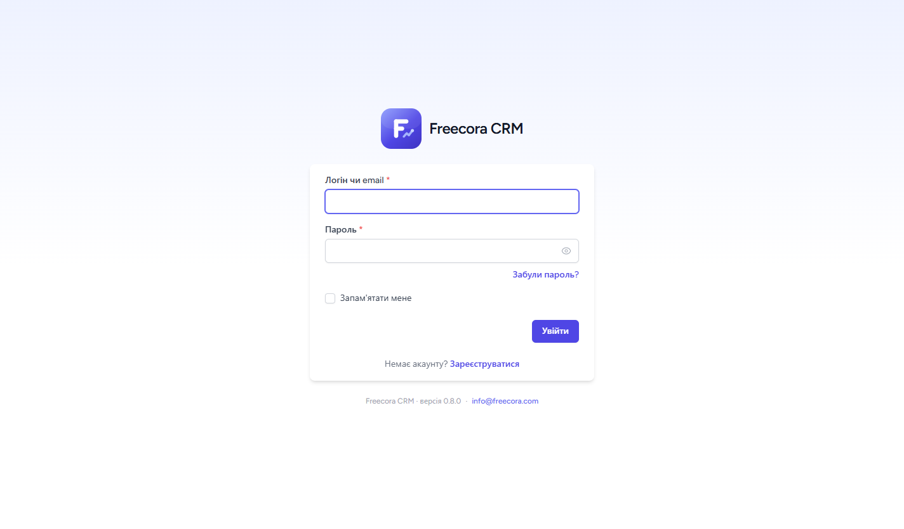
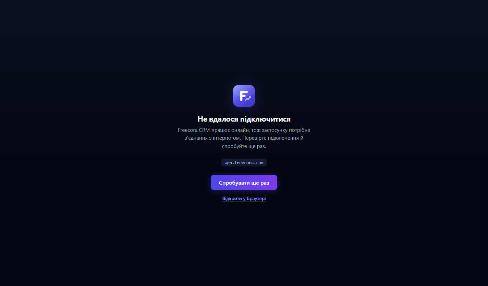

<div align="center">


# Freecora CRM для Windows

Десктопна обгортка для [Freecora CRM](https://freecora.com) — CRM для керування клієнтами, проєктами та фінансами.

[](https://www.electronjs.org/)
[](#встановлення)
[](LICENSE)

</div>

---

## Що це

Freecora CRM працює у браузері. Цей застосунок відкриває її у власному вікні Windows — з окремою іконкою на панелі задач, ярликом у меню «Пуск» і збереженою сесією, щоб не вводити логін щоразу.

Власного інтерфейсу застосунок не малює: сайдбар, шапку й усі розділи — **Дашборд, Тайм-трекер, Проєкти, Клієнти, Фінанси, Цілі, Інструменти, Налаштування** — віддає сама CRM. Це свідоме рішення: коли CRM оновлюється, застосунок отримує зміни автоматично й нічого не треба перезбирати.

<div align="center">
    
</div>

### Що додає обгортка поверх браузера

| | |
|---|---|
| **Окремий застосунок** | Свій `.exe`, іконка Freecora на панелі задач, ярлики на робочому столі та в меню «Пуск» |
| **Збережена сесія** | Логін не злітає між запусками — сесія живе в окремому сховищі застосунку |
| **Пам'ять вікна** | Розмір, позиція та розгорнутий стан відновлюються при наступному запуску |
| **Нативне меню** | Перезавантаження, масштаб, повний екран, «На головну», «Про застосунок» |
| **Зовнішні посилання** | Відкриваються в системному браузері, а не всередині вікна CRM |
| **Один екземпляр** | Повторний запуск не плодить вікна, а фокусує наявне |
| **Своя сторінка помилки** | Брендований екран «Не вдалося підключитися» з кнопкою повтору |

Власні екрани застосунку — сплеш і сторінка помилки — намальовані у фірмовому стилі Freecora й підтримують темну тему системи:

<div align="center">
    
</div>

---

## Встановлення

Готові збірки — на сторінці [Releases](https://github.com/mrnko/freecora-desktop/releases):

- **`Freecora-CRM-Setup-<версія>.exe`** — інсталятор: створює ярлики, реєструє застосунок у списку встановлених програм, дозволяє вибрати каталог.
- **`Freecora-CRM-<версія>-portable.exe`** — портативна версія: один файл, нічого не встановлює.

Вимоги: **Windows 10 або новіша**, x64.

> [!NOTE]
> **Попередження SmartScreen.** Збірки не підписані сертифікатом розробника, тож при першому запуску Windows покаже екран «Windows захистив ваш ПК». Натисніть **Детальніше → Виконати в будь-якому разі**. Це очікувано для застосунків без платного code-signing сертифіката.

---

## Розробка

Потрібен [Node.js](https://nodejs.org/) 20 або новіший (версія зафіксована в [`.nvmrc`](.nvmrc)).

```bash
npm install
npm start
```

Запуск із відкритими інструментами розробника:

```bash
npm run dev
```

### Інше середовище

За замовчуванням застосунок відкриває `https://app.freecora.com`. Змінна оточення `FREECORA_URL` дозволяє підключитися до іншого середовища — наприклад до локального:

```bash
set FREECORA_URL=https://app.freecora.test && npm start
```

Білий список хостів для внутрішньої навігації будується автоматично від цієї адреси, тож правити код не потрібно.

---

## Збірка

```bash
npm run build:win
```

Артефакти зʼявляться в `dist/`. Швидка перевірка без інсталятора:

```bash
npm run build:dir
```

Детальніше — у [`docs/BUILD.md`](docs/BUILD.md).

### Іконки

Іконка застосунку генерується процедурно з фірмового логотипа Freecora, без зовнішніх залежностей:

```bash
npm run icons
```

Скрипт [`scripts/generate-icons.mjs`](scripts/generate-icons.mjs) малює логотип через signed-distance fields у тій самій системі координат, що й `favicon.svg` у репозиторії CRM, і пакує результат у багаторозмірний `build/icon.ico` (16, 24, 32, 48, 64, 128, 256) та `build/icon.png` 512×512. Згенеровані файли лежать у репозиторії, тож для збірки скрипт запускати не обовʼязково.

---

## Структура проєкту

```
freecora-desktop/
├─ build/                   ресурси збірки
│  ├─ icon.ico              іконка застосунку (генерується)
│  ├─ icon.png              512×512 для документації (генерується)
│  └─ logo.svg              вихідний логотип Freecora
├─ docs/
│  ├─ BUILD.md              детально про збірку
│  └─ screenshots/          знімки для README
├─ scripts/
│  └─ generate-icons.mjs    генератор іконок (нуль залежностей)
├─ src/
│  ├─ main.js               головний процес: вікно, навігація, IPC
│  ├─ menu.js               нативне меню
│  ├─ config.js             адреси, білий список хостів, дефолти вікна
│  ├─ window-state.js       памʼять геометрії вікна
│  ├─ preload.cjs           місток до сторінок застосунку
│  └─ renderer/
│     ├─ loading.html       брендований сплеш
│     └─ error.html         сторінка «немає зʼєднання»
└─ electron-builder.yml     конфігурація NSIS та portable
```

Залежності — рівно дві: `electron` і `electron-builder`. Жодного бандлера, жодного рантайм-пакета.

---

## Безпека

Вікно CRM працює з `contextIsolation`, `sandbox` і вимкненою інтеграцією Node. Preload віддає сторінкам застосунку лише три дії (версії, повтор підключення, відкрити в браузері) і жодного доступу до файлової системи. Дозволи браузера обмежені сповіщеннями, записом у буфер обміну та повноекранним режимом; геолокація, камера й мікрофон відхиляються.

Про вразливості — [`SECURITY.md`](SECURITY.md).

---

## Ліцензія

[MIT](LICENSE) — як і сама [Freecora CRM](https://freecora.com).
